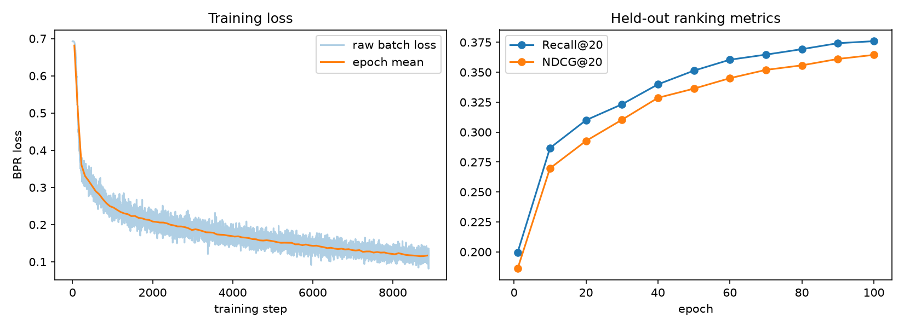
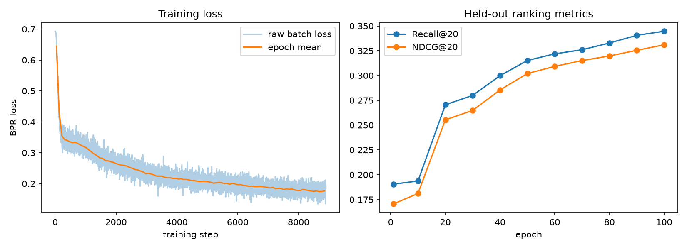
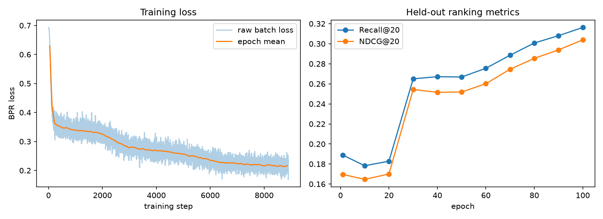

# LightGCN Collaborative Filtering: An Empirical Study on GNN Over-Smoothing

A PyTorch Geometric implementation of **LightGCN** (He et al., SIGIR 2020) evaluated on the **MovieLens-100K** (`ua.base` / `ua.test`) benchmark. Beyond building a fully vectorized training and evaluation pipeline, this project conducts an ablation study across message-passing depths ($L \in \{1, 3, 6\}$) to demonstrate how deeper neighborhood aggregation triggers **graph over-smoothing** on small-world bipartite interaction graphs.

---

## 1. Architecture & Engineering Highlights

* **Bipartite Node-Offset Wiring:** Maps $943$ users to node indices $[0, 942]$ and shifts $1,682$ items by $+943$ to $[943, 2624]$ within a unified $2,625$-node graph. Interactions are stacked bidirectionally ($\text{User} \leftrightarrow \text{Item}$) into an `edge_index` tensor of shape `[2, 181140]`.
* **Vectorized Rejection Negative Sampling:** Uses an $O(1)$ boolean lookup matrix (`train_mat` of shape `[943, 1682]`) and iterative boolean masking (`while bad.any()`) to resample collided items exclusively for affected batch slots without Python `for` loops.
* **Bayesian Personalized Ranking (BPR) & Layer-0 $L_2$ Regularization:** Optimizes pairwise ranking margins by penalizing instances where an unwatched item scores higher than a watched item:
  $$\mathcal{L}_{\text{BPR}} = -\frac{1}{|B|} \sum_{(u, i, j) \in B} \ln \sigma(\hat{y}_{ui} - \hat{y}_{uj}) + \lambda \frac{\|E_u^{(0)}\|_2^2 + \|E_i^{(0)}\|_2^2 + \|E_j^{(0)}\|_2^2}{2|B|}$$
  Rather than using global optimizer `weight_decay` (which penalizes inactive item embeddings every step), $L_2$ regularization is applied strictly to active batch indices in the initial learnable Layer-0 embedding table $E^{(0)}$.
* **Loop-Free Top-$K$ Ranking Evaluation:** Computes all-pairs preference scores via matrix multiplication (`emb[:n_users] @ emb[n_users:].T`), masks seen training interactions with $-\infty$, extracts top-$20$ candidates via `.topk()`, and calculates **Recall@20** and **NDCG@20** using 2D tensor broadcasting (`torch.gather` and broadcasted `IDCG` masks).
* **Single-Batch Overfit Sanity Check:** Includes a `SANITY_OVERFIT` diagnostic mode that verifies gradient flow by driving BPR loss toward $0.0000$ on a fixed mini-batch of $1,024$ interactions prior to full-scale training.

---

## 2. Hyperparameter Configuration

| Hyperparameter | Value | Description |
| :--- | :--- | :--- |
| `EMB_DIM` | `64` | Latent embedding dimension ($d$) |
| `NUM_LAYERS` | `1, 3, 6` | Message-passing propagation hops ($L$) |
| `LR` | `1e-3` | Adam learning rate |
| `BATCH` | `1024` | Training mini-batch size |
| `REG` | `1e-4` | Layer-0 $L_2$ regularization coefficient ($\lambda$) |
| `EPOCHS` | `100` | Full passes over the $90,570$ training interactions |
| `K` | `20` | Cutoff rank for Recall@$K$ and NDCG@$K$ |

---

## 3. Over-Smoothing Ablation Study ($L = 1, 3, 6$)

In LightGCN, node embeddings at layer $k$ are computed via symmetric degree-normalized neighborhood aggregation without feature transformation matrices or non-linear activations:

$$e_u^{(k+1)} = \sum_{i \in \mathcal{N}_u} \frac{1}{\sqrt{|\mathcal{N}_u|}\sqrt{|\mathcal{N}_i|}} e_i^{(k)}, \qquad e_u = \frac{1}{L+1} \sum_{k=0}^{L} e_u^{(k)}$$

### Final Epoch-100 Held-Out Ranking Performance (`ua.test`)

> *Note: Replace the bracketed placeholders below with the final row (`epoch == 100`) from `metrics_1layer.csv`, `metrics_3layer.csv`, and `metrics_6layer.csv`.*

| Model Depth | Final BPR Loss | Recall@20 | NDCG@20 | Behavioral Observation |
| :--- | :--- | :--- | :--- | :--- |
| **1-Layer** (`metrics_1layer.csv`) | `<insert>` | `<insert>` | `<insert>` | Captures direct 1-hop user-item interactions; fast convergence. |
| **3-Layer** (`metrics_3layer.csv`) | `<insert>` | `<insert>` | `<insert>` | Captures 3-hop collaborative signal; optimal ranking balance. |
| **6-Layer** (`metrics_6layer.csv`) | `<insert>` | `<insert>` | `<insert>` | Suffers from **over-smoothing** as 6 hops mix global graph neighborhoods. |

### Training Loss & Ranking Metric Curves

#### 1-Layer Propagation (`NUM_LAYERS = 1`)


#### 3-Layer Propagation (`NUM_LAYERS = 3`)


#### 6-Layer Propagation (`NUM_LAYERS = 6`)


### Key Takeaway
While $1$ to $3$ layers capture localized collaborative filtering signals (users who watched similar movies), increasing depth to $6$ layers degrades ranking quality and slows convergence. Because the MovieLens-100K bipartite graph is relatively small ($2,625$ total nodes) and dense, $6$ hops of message passing cause node representations to converge toward the stationary degree-weighted global mean—erasing the personalized preference differences needed for sharp Top-$20$ ranking.

---

## 4. Repository Structure & Reproduction

* `SPIKE.py` — Complete LightGCN training, negative sampling, vectorized evaluation, and plotting script.
* `metrics_1layer.csv`, `metrics_3layer.csv`, `metrics_6layer.csv` — Logged Recall@20 and NDCG@20 trajectories every 10 epochs.
* `loss_curve_1layer.png`, `loss_curve_3layer.png`, `loss_curve_6layer.png` — Side-by-side training loss and held-out ranking metric plots.

### Running the Experiment
```bash
pip install torch torch-geometric pandas numpy matplotlib
python SPIKE.py
